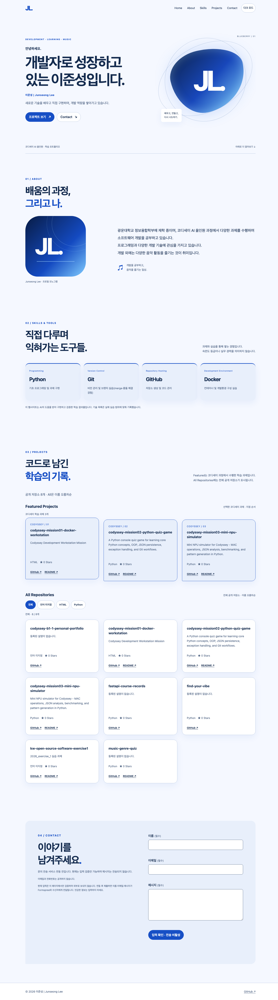

# 웹 포트폴리오 자습 교재

코디세이 B1-1 **「나를 소개하는 웹페이지 처음부터 만들기」** · AI/SW 기초 / 웹 기초와 프론트엔드 · 필수 과제 / 학습 기준 80시간

이 문서는 사이트 사용 안내와 함께 HTML·CSS·JavaScript를 다시 공부하기 위한 강의노트입니다. 학습자의 이해나 소감을 대신 주장하지 않습니다. 실제 구현, 실행 결과, 앞으로 직접 확인할 사항을 구별합니다. 1차 README의 보존본은 [여기](./docs/history/phase1/README.md)에 있으며, 아래 내용은 2차 구현을 기준으로 새로 작성했습니다.

## 0. 문서 사용법과 학습 로드맵

선수지식은 폴더/파일을 열고 저장하는 방법, 브라우저를 사용하는 방법입니다. 명령줄이나 JavaScript를 이미 숙달했다고 가정하지 않습니다. 먼저 2절대로 사이트를 열고 버튼을 조작한 다음, 화면과 소스를 나란히 놓고 읽으세요. 실습은 원본을 복사한 폴더에서 진행하면 제출 파일을 안전하게 보존할 수 있습니다.

| 순서 | 읽을 절 | 이번 단계의 학습 목표 |
| --- | --- | --- |
| 실행·관찰 | 1~2 | 정적 사이트를 실행하고 각 파일의 역할 설명 |
| 구조·표현 | 3~4 | HTML의 의미와 CSS 배치 방식 구별 |
| 동작 원리 | 5~8 | 이벤트, 상태, 렌더링과 테마 우선순위 설명 |
| 외부 데이터 | 9~11 | 비동기 요청, 필터, 입력 검증과 실제 전송 구별 |
| 품질·배포 | 12~15 | 오류 재현, 검증 증거, Git/Pages 경로 이해 |
| 직접 재현 | 16~18 | 최소 실습·복습 질문·제출 정보 |

먼저 알아둘 용어: **DOM**은 HTML을 브라우저가 객체 트리로 만든 것, **이벤트**는 클릭 같은 발생 사실, **상태**는 현재 선택/요청 결과를 담은 값, **렌더링**은 그 값을 화면에 반영하는 과정입니다. **API**는 외부 서비스와 데이터를 주고받는 규칙입니다. 자세한 용어는 17절에서 다시 설명합니다.

읽기 순서는 `index.html → css/style.css → js/config.js → js/main.js`입니다. `main.js`에서는 `renderTheme()`처럼 이름에 render가 붙은 함수와 그 함수를 부르는 이벤트를 짝지어 보세요. 코드를 모두 암기하기보다 **누가 상태를 바꾸고 누가 화면을 갱신하는가**를 추적하는 것이 목표입니다.

## 1. 미션과 현재 결과물

정적 포트폴리오의 구조·반응형·상태 관리·GitHub API·문의 폼을 직접 구현하는 과제입니다. React, Vue, jQuery, Bootstrap, Tailwind와 외부 UI 라이브러리를 사용하지 않습니다. HTML5/CSS3/Vanilla JavaScript만으로 실행하며 npm이나 빌드 서버가 없습니다. 테스트에 쓰는 Python은 배포 사이트의 의존성이 아닙니다.

필수 조건은 Header, Hero, About, Skills, Projects, Contact, Footer와 메뉴/스크롤/다크 모드/Observer/API/폼 검증입니다. 추가로 언어 필터, Hero 타이핑, 외부 메일 전송 코드, 시스템 테마 감지의 보너스 4개를 구현했습니다. **메일 전송 코드가 있다는 것과 실제 메일이 도착했다는 것은 다릅니다.**

| 상태 | 현재 의미 |
| --- | --- |
| LOCAL_IMPLEMENTATION | 필수 기능과 보너스 4개의 로컬 코드 구현 |
| LOCAL_VERIFIED | 최신 실제 검증 결과는 [TEST_REPORT](./TEST_REPORT.md) 및 [JSON](./docs/browser-results.json) 참조 |
| EMAIL_LIVE_VERIFIED | PASS — 사용자가 실제 발송 및 스팸함 수신을 직접 확인 (2026-10-30) |
| GITHUB_PAGES_VERIFIED | PASS — 실제 배포 자산 일치 및 Chrome 117 PASS (2026-10-30) |
| SUBMISSION_READY | BLOCKED — 디자인 사용자 최종 승인 기록 없음 |

개인화는 승인된 25개 키를 유지하고 [DECISIONS](./DECISIONS.md)에 추적합니다. Blueberry Signal은 색조를 참조한 제안 디자인입니다. 상표 이미지나 기타 사진을 복제하지 않았고, 디자인의 최종 시각 승인까지 받았다고 주장하지 않습니다. 프로필은 실물 사진 대신 직접 작성한 `JL` 모노그램 SVG입니다.

정적 파일은 브라우저에서 실행되고 GitHub API는 저장소 정보를 제공하며 Formspree가 문의 처리를 담당합니다. 사용자 제공 공개 ID `mdeezyjq`와 `email.enabled=true`를 적용했습니다. 방문자가 제출하면 `https://formspree.io/f/mdeezyjq`로 요청합니다. 사용자가 실제 테스트 메시지 발송과 스팸함 수신을 직접 확인했습니다(2026-10-30 사용자 보고). 이번 자동 검사는 mock만 사용하며 추가 메일은 발송하지 않습니다. Header·Hero·프로필 이니셜은 모두 `JL`입니다. 수신 주소와 메시지 원문은 공개하지 않습니다.

## 2. 개발 환경, 실행 경로와 디렉터리

VS Code에서 **현재 codyssey-b1-1-personal-portfolio 폴더 자체**를 엽니다. Live Server 확장이 있다면 `index.html` 우클릭 → Open with Live Server를 실행합니다. 표시된 로컬 URL을 브라우저에서 엽니다. 확장 UI를 자동으로 조작해 검증한 것은 아니며, 테스트에서는 같은 정적 파일을 Python HTTP 서버로 제공했습니다.

대안 명령은 프로젝트 폴더의 터미널에서 실행합니다.

```sh
# macOS/Linux: Python 3가 설치되어 있을 때
python3 -m http.server 5500 --bind 127.0.0.1
```

```powershell
# Windows: Python Launcher가 설치되어 있을 때
py -m http.server 5500 --bind 127.0.0.1
```

그다음 `http://127.0.0.1:5500`을 엽니다. 종료는 해당 터미널에서 Ctrl+C입니다. 위 명령은 실행 방법이며 과거 로그가 아닙니다. `file://`로 파일을 직접 열면 origin·저장소·네트워크 동작이 HTTP와 달라질 수 있으므로 HTTP 실행을 기준으로 확인합니다.

```text
codyssey-b1-1-personal-portfolio/
├── index.html                 문서 구조와 JS 없는 환경의 완전한 대체 문구
├── css/style.css              기본 UI, Blueberry 표현, 반응형·테마
├── js/config.js               개인화 25개, GitHub/README 캐시, 메일·공개 상태
├── js/main.js                 이벤트·상태·렌더링·API·폼
├── images/profile-monogram.svg 실제 프로필 그래픽과 favicon
├── tests/
│   ├── static_checks.py       구조·경로·승인 계약 검사
│   ├── browser_checks.py      Chrome 실제 DOM/스크린샷·mock 시험
│   ├── release_check.py       로컬 검증과 전체 제출 조건을 분리
│   └── verify_readmes.py      수동 실행하는 읽기 전용 README 검증
├── docs/
│   ├── REQUIREMENTS_MATRIX.md 원문→구현→테스트→증거
│   ├── EMAIL_SETUP.md         사용자가 할 외부 메일 설정
│   ├── personalization-contract.json 사용자 승인 값의 비교 기준
│   ├── readme-verification.json README 실제 경로·브랜치 기록
│   ├── browser-results.json   최신 실행이 생성한 결과와 소스 해시
│   ├── screenshots/           desktop.png, mobile.png, dark.png 외 3종
│   └── history/phase1/        1차 문서·57개 결과·캡처 보존
├── DECISIONS.md
├── TEST_REPORT.md
├── README.md
└── .gitignore
```

실제 `index.html`의 연결입니다.

```html
<link rel="stylesheet" href="./css/style.css">
<script src="./js/config.js" defer></script>
<script src="./js/main.js" defer></script>
```

브라우저는 HTML을 읽으면서 파일을 요청합니다. 외부 고전 스크립트의 `defer`는 HTML 파싱 후 선언 순서대로 실행하므로 설정이 main보다 먼저 준비됩니다. `async`로 바꾸면 이 순서 보장이 없어집니다. DOMContentLoaded는 defer 스크립트 실행을 기다립니다. 단, 스크립트가 시작한 fetch 응답까지 모두 기다리는 것은 아닙니다. [MDN script 설명](https://developer.mozilla.org/en-US/docs/Web/HTML/Reference/Elements/script).

`./css/style.css`는 현재 페이지 폴더 아래입니다. 목표 Pages 주소가 `/codyssey-b1-1-personal-portfolio/`라면 그 아래의 CSS를 찾습니다. `/css/style.css`처럼 슬래시로 시작하면 도메인의 최상위에서 찾게 되어 프로젝트 페이지에서 404가 날 수 있습니다. 테스트 서버는 **실제 목표 프로젝트 하위 경로**로 파일을 제공하며 해당 경로에서 CSS/JS/프로필 로딩을 검사합니다.

하위 경로를 수동 재현하려면 **복사본** 폴더 이름을 `codyssey-b1-1-personal-portfolio`로 정하고 그 부모 폴더에서 위 서버를 실행합니다. 브라우저에서 `http://127.0.0.1:5500/codyssey-b1-1-personal-portfolio/`를 열면 됩니다. 원본 폴더를 옮기거나 이름을 바꿀 필요는 없습니다.

## 3. HTML 기초와 시맨틱 설계

HTML은 문서의 내용과 의미를 선언합니다. CSS처럼 위치를 정하거나 JavaScript처럼 이벤트를 처리하는 언어가 아닙니다. `<!doctype html>`은 표준 모드를, `lang="ko"`는 기본 언어를, viewport는 모바일의 레이아웃 기준을 알려 줍니다. `head`는 제목·메타·리소스, `body`는 실제 문서 내용입니다.

브라우저는 태그를 부모·자식 관계의 DOM 트리로 만듭니다. 이 프로젝트의 핵심 구조는 다음과 같습니다.

```text
body
├── header > nav             사이트 이동
├── main
│   ├── section#home         Hero와 CTA
│   ├── section#about        소개와 프로필 img
│   ├── section#skills       기술 목록
│   ├── section#projects     API에서 만든 article 카드
│   └── section#contact      form
└── footer                   저작권과 GitHub 링크
```

`section`은 주제가 있는 구역이며 제목으로 설명합니다. `article`은 독립적으로 읽을 수 있는 개별 저장소 카드입니다. 모든 영역을 div로만 만들면 시각적 배치는 가능하지만 문서 의미가 약해집니다. 이 문서는 Hero의 h1 하나, 각 구역 h2, Skills/프로젝트 하위 그룹 h3, 프로젝트 카드 h4로 이어집니다. 글자 크기 때문에 제목 수준을 건너뛰지 않습니다.

이 프로젝트의 실제 CTA와 대상은 다음처럼 연결됩니다.

```html
<a class="button" href="#contact">Contact <span aria-hidden="true">↘</span></a>
```

`href="#contact"`는 id가 contact인 요소로 이동합니다. 링크 `<a>`는 이동, `<button>`은 메뉴·테마·제출 같은 동작에 사용합니다. 버튼처럼 보이게 CSS를 입혀도 CTA는 여전히 링크입니다. CTA는 방문자가 다음 행동을 할 수 있도록 안내하는 요소를 뜻합니다.

폼의 실제 `label for="contact-email"`과 `input id="contact-email"`은 같은 값을 사용합니다. 라벨을 눌러도 입력란에 초점이 갑니다. placeholder는 입력 후 사라지므로 라벨을 대체하지 않습니다. `required`, `type="email"`, `maxlength`는 필드 규칙이고, `aria-describedby="email-error"`는 해당 오류 설명을 연결합니다.

About의 ``에는 실제 SVG 상대경로, width/height, “프로필 모노그램 그래픽”이라는 alt가 있습니다. 실제 얼굴 사진이라고 설명하지 않습니다. Hero의 추상 장식은 `aria-hidden="true"`로 불필요한 낭독을 제외했습니다. 본문 바로가기 링크는 키보드 이용자가 긴 메뉴를 건너뛰게 합니다.

**확인:** Tab으로 링크/버튼/폼을 이동하고 라벨을 클릭하세요. 개발자 도구 Elements에서 `main → section → heading` 계층을 확인하세요. 흔한 실수는 id 중복, `for` 불일치, 장식용 이미지를 의미 있는 사진처럼 설명하는 것입니다. 정적 검사로 연결 오류를 찾지만 실제 음성 읽기까지 자동 인증하지는 않습니다.

## 4. CSS 기초, 레이아웃과 반응형

CSS는 선택한 요소에 표현 규칙을 적용합니다. `.button`은 class 선택자, `#project-grid`는 id 선택자, `[data-theme="dark"]`는 속성 선택자입니다. 여러 규칙이 충돌하면 중요도·계층·선택자 구체성·소스 순서 등이 결정합니다. 같은 우선순위라면 뒤쪽 규칙이 앞쪽 값을 덮습니다. 현재 파일도 기본 UI 뒤에 2차 표현을 추가하므로 앞부분만 보고 최종 스타일을 판단하면 안 됩니다.

글꼴/글자색은 보통 부모에서 상속되지만 margin이나 border는 자동 상속되지 않습니다. `box-sizing: border-box`는 지정한 너비에 padding과 border를 포함해 폭 계산을 단순하게 합니다. 이 설정이 없으면 카드 너비에 안쪽 여백이 더해져 예기치 않은 넘침이 생길 수 있습니다.

실제 변수 사용 예입니다.

```css
.text-accent { color: var(--color-accent); }
```

`:root`의 `--color-accent`를 바꾸면 이를 참조하는 제목·버튼·필터가 함께 바뀝니다. 다크 모드는 `[data-theme="dark"]`에서 동일한 변수 이름의 값을 교체합니다. 모든 컴포넌트에 어두운 색을 각각 하드코딩하는 방식보다 누락을 줄일 수 있습니다.

**Flexbox**는 한 방향의 정렬에 적합합니다. `.navigation`은 로고·메뉴·버튼을 가로 정렬하고 모바일에서는 줄을 바꿉니다. **Grid**는 행과 열을 함께 다루므로 프로젝트 카드에 사용합니다. 실제 카드 열 규칙은 다음과 같습니다.

```css
grid-template-columns: repeat(auto-fit, minmax(min(100%, 280px), 1fr));
```

`auto-fit`은 들어갈 수 있는 열 수를 자동 계산합니다. `minmax`는 최소/최대 폭을 정하고, `1fr`은 남는 공간을 나눕니다. 내부 `min(100%, 280px)` 때문에 부모 폭이 280px보다 작아도 카드가 부모보다 넓어지지 않습니다. 단순히 `minmax(280px,1fr)`만 쓰면 좁은 컨테이너에서 넘칠 수 있습니다.

모바일 기본 CSS에 768px, 1024px 이상 규칙을 추가하는 **mobile-first** 방식입니다. `rem`은 루트 글자 크기 기준이고, `clamp(2.8rem, 5.2vw, 4.75rem)`은 Hero 글자 크기에 하한/유동값/상한을 줍니다. 긴 저장소명에는 `overflow-wrap`, Grid 자식에는 `min-width:0`을 사용합니다. 페이지 전체를 `overflow-x:hidden`으로 가려 결함을 숨기지 않습니다.

버튼과 카드의 hover는 transform과 그림자로 반응하며 transition이 변화를 이어 줍니다. 키보드에는 `:focus-visible` 외곽선을 별도로 둡니다. hover만 제공하면 키보드 사용자가 위치를 알기 어렵습니다. `prefers-reduced-motion: reduce`에서는 애니메이션과 transition을 끄며, 이는 다크 모드 설정과 독립적입니다.

**확인:** DevTools 반응형 모드에서 375/768/1024/1440px로 바꾸고 카드 열/메뉴를 관찰하세요. 두 테마의 일반 글자 대비는 테스트에서 4.5:1 이상을 계산합니다. 그라데이션 장식까지 모든 접근성 항목을 인증했다는 뜻은 아닙니다. 프로필 이미지는 width/height 속성을 유지하면서 CSS `height:auto`로 실제 비율을 보존합니다.

## 5. JavaScript 실행과 DOM 조작

JavaScript는 실행 순서가 있는 프로그램입니다. `config.js`는 확정값을 제공하고 `main.js`는 즉시 실행 함수 내부에 로직을 둡니다. 이 때문에 `renderTheme()` 같은 내부 함수를 콘솔에서 전역 함수처럼 직접 호출할 수는 없습니다. 실습에서는 버튼 이벤트를 발생시키거나 DOM을 관찰합니다.

`const`는 변수의 재할당을 막지만 객체 내용까지 자동으로 불변으로 만들지는 않습니다. 실제 `const state`의 `state.theme`는 바뀝니다. `let`은 스크롤 예약 플래그, API 페이지 번호, 타이핑 글자 인덱스처럼 재할당이 필요할 때 사용합니다. 두 선언은 블록 스코프를 가지며 선언 전에 접근하면 오류가 납니다. var는 사용하지 않습니다.

실제 DOM 선택 도우미입니다.

```js
const select = (selector) => document.querySelector(selector);
```

화살표 함수는 인자를 받아 결과를 반환하는 함수 표현입니다. querySelector는 첫 일치 요소, querySelectorAll은 일치한 요소 목록(NodeList)을 반환합니다. 없는 요소는 null이므로 id를 바꾸면 선택자도 함께 수정해야 합니다. `const { github, personal, email } = window.PortfolioConfig`는 객체에서 같은 이름의 값을 꺼내는 구조분해입니다.

`textContent`는 문자열을 글자로 표시하고 `innerHTML`은 HTML로 해석합니다. 악의적인 `` 문자열을 innerHTML로 넣으면 XSS 위험이 있습니다. 과제의 동적 HTML 조건은 `makeProjectCard()`의 **고정 마크업 + 내부 순번**으로 충족하고 API 데이터는 별도 textContent로 넣습니다. [MDN innerHTML 설명](https://developer.mozilla.org/en-US/docs/Web/API/Element/innerHTML).

아래는 실제 코드에서 순번 부분을 발췌한 것입니다. featured는 내부 boolean, index는 배열 순번입니다.

```js
${featured ? `<span class="project-index">CODYSSEY / ${String(index + 1).padStart(2, '0')}</span>` : ''}
```

이 조각은 바깥 템플릿 리터럴 안에 있습니다. 독립적인 실행문으로 콘솔에 붙여 넣는 코드가 아닙니다. 템플릿 리터럴의 `${...}`가 값을 보간한다는 점을 보여 줍니다. **보간이 자동 HTML 이스케이프를 뜻하지는 않습니다.**

카드 링크는 `createElement('a') → textContent/href 설정 → append()`로 만들며, 목록은 `replaceChildren(...cards)`로 교체합니다. classList.add는 스크롤 헤더·진입 상태를 추가하고 remove는 해제하며 toggle은 메뉴·성공 상태를 boolean에 맞춥니다.

모든 이벤트는 `addEventListener()`로 연결합니다. 이벤트 객체의 `preventDefault()`는 폼의 기본 페이지 이동을 막지만 전파까지 중단하지는 않습니다. 클릭은 자식에서 부모로 버블링할 수 있어 `#language-filters`의 리스너 하나가 `event.target.closest('button[data-language]')`로 실제 버튼을 찾습니다. 동적 버튼마다 리스너를 다시 붙일 필요가 없습니다.

**확인:** 콘솔에서 `document.querySelector('#theme-toggle').textContent`를 읽고 클릭 전후를 비교하세요. 오류 fixture는 악성 문자열이 실제 태그로 생성되지 않는지 검사합니다. 소스에 문법이 있다는 정적 검사와, 이벤트가 실제 DOM을 바꾼다는 브라우저 검사를 구별하세요.

## 6. 이벤트 → 상태 → 렌더링 핵심 강의

상태는 화면에 직접 써 둔 문구가 아니라 JS가 기억하는 현재 값입니다. 렌더 함수가 상태를 해석해 DOM을 갱신하면 이벤트 처리와 표현이 분리됩니다. 이 분리는 React 같은 UI 도구에서도 중요한 개념이지만 **현재 사이트는 React를 사용하지 않고 직접 DOM을 변경**합니다.

### 테마 사례

```text
#theme-toggle click
  → setTheme('dark')
  → state.theme='dark', manualTheme=true
  → localStorage 저장 시도
  → renderTheme()
  → html[data-theme=dark], 버튼 문구·aria-pressed 갱신
```

초기 state.theme은 light지만 `initializeTheme()`가 저장값/시스템값으로 곧 복원합니다. 저장 실패는 try/catch로 격리하므로 renderTheme까지 도달합니다. 화면에서 CSS 변수 값이 바뀌는 것은 data-theme 선택자가 달라졌기 때문입니다.

### API 사례

```text
최초 실행 / 재시도 click
  → fetchProjects(): status='loading'
  → renderProjects(): 로딩·aria-busy
  → await fetch / JSON 검증
  → status='success' 또는 'empty' 또는 'error'
  → renderProjects(): 카드·오류·재시도 표시
```

API가 끝나기 전에 “프로젝트가 없다”고 표시하면 로딩과 빈 결과를 혼동하게 됩니다. 별도 상태를 두어 결과를 아직 모르는 시점과 실제 빈 배열을 구별합니다. `state.projects.items`는 원본이고 `language`는 필터 선택입니다.

### 폼 사례

```text
input → values/errors 변경 → invalid 또는 idle → renderFormState()
submit → preventDefault → 전체 검증
  ├─ 오류 → invalid → 필드별 오류와 첫 오류 초점
  ├─ 설정 없음 → error → 검증 완료·미전송 안내
  └─ 설정 있음 → submitting → await POST
                              ├─ success → reset·접수 안내
                              └─ error → 입력 유지·실패 안내
```

`state.form.status` 초기값은 idle입니다. 입력 오류와 서비스 실패는 원인이 다릅니다. 전송 버튼을 눌렀다는 이유만으로 success로 바꾸지 않습니다. 성공 후 다시 입력하면 idle로 돌아가 이전 성공 안내가 사라집니다.

메뉴의 보조 사례는 `menuOpen → renderMenu → active/aria-expanded`, 필터는 `language → renderRepositoryList → 카드/건수/aria-pressed`입니다. 필터 클릭에서 fetchProjects를 호출하지 않는 점이 차이입니다.

**확인 실습:** DevTools Elements에서 html의 data-theme, 프로젝트 그리드의 aria-busy, 폼 상태의 data-state를 차례로 관찰하세요. Network를 느리게 설정하면 loading 상태를 더 오래 볼 수 있습니다. 흔한 실수는 상태를 바꾸고 render를 호출하지 않거나, DOM만 고쳐 다음 렌더에서 덮이는 것입니다.

## 7. 주요 인터랙션의 실행 순서

메뉴 버튼은 click에서 `menuOpen`을 반전시키고 `renderMenu()`가 `classList.toggle('active', state.menuOpen)`와 aria-expanded를 함께 갱신합니다. 링크 선택·Escape·외부 클릭·메뉴 밖 초점 이동은 닫기로 이어집니다. Escape 후 버튼에 초점을 돌려 키보드 사용자가 위치를 잃지 않도록 합니다.

앵커 리스너는 존재하는 id인지 확인하고 기본 동작을 막은 뒤, 메뉴를 닫고 대상에 `focus({preventScroll:true})`, `scrollIntoView()`를 적용합니다. section의 `tabindex="-1"`은 일반 Tab 순서에 넣지 않으면서 프로그램으로 초점을 줄 수 있게 합니다. CSS의 `scroll-padding-top:7rem`은 sticky header에 내용이 가려지는 문제를 줄입니다.

| 인터랙션 | 실제 기준 | 경계 검증 |
| --- | --- | --- |
| 헤더 배경 변경 | scrollY >= 60 | 59는 기본, 60은 scrolled |
| 맨 위 버튼 | scrollY >= 300 | 299는 숨김, 300은 표시 |
| 진입 효과 | IntersectionObserver threshold 0.2 | 요소의 20% 이상 교차 시 적용 |
| 타이핑 | 최초 180ms 대기, 글자 간 120ms | 인사말 1회, 완료 후 타이머 정리 |

scroll 이벤트는 빠르게 반복됩니다. `scrollScheduled`가 이미 true라면 새 작업을 예약하지 않고 requestAnimationFrame 안에서 한 번 처리합니다. 이는 모든 scroll 이벤트가 사라진다는 뜻이 아니라 프레임당 DOM 갱신 중복을 줄이는 방식입니다. 리스너는 passive이고 스크롤을 preventDefault하지 않습니다.

Observer는 해당 요소가 보였을 때 is-visible을 추가한 뒤 관찰을 해제합니다. 원래 콘텐츠를 opacity:0으로 숨기지 않으므로 Observer/JS가 없어도 읽을 수 있습니다. 카드 전체가 아주 길다면 실제로 20%가 화면에 들어와야 하므로 테스트도 카드를 화면 중앙으로 이동시킵니다.

`setupTyping()`은 승인된 짧은 인사말 `안녕하세요.`에만 실제 글자 단위 변경을 적용합니다. 초기 HTML에는 완전한 문장이 있습니다. 실행 후 정적 sr-only 텍스트와 aria-hidden 시각 텍스트를 분리하고, 숨긴 reserve로 문장 크기를 확보합니다. 스크린리더에 글자별 aria-live 알림을 보내지 않습니다. reduced-motion이면 생략하고 탭이 배경으로 가면 즉시 완성하여 무한 루프를 피합니다.

**확인:** 메뉴를 Tab/Enter/Escape로 조작하고 59/60/299/300에서 클래스·버튼을 확인하세요. 타이핑은 새로고침 후 한 번만 실행됩니다. 기준값을 변경하면 tests와 이 표도 함께 바꿔야 합니다. 화면의 다른 요소를 숨기는 방식으로 실패한 Observer 검사를 통과시키면 안 됩니다.

## 8. 다크 모드와 지속성

테마에는 **현재 색상**과 **누가 선택했는가**라는 두 상태가 필요합니다. 시스템이 dark로 바뀌었다고 사용자의 명시적인 light 선택을 덮어쓰면 안 되기 때문입니다. `initializeTheme()`는 localStorage의 `portfolio-theme`이 light/dark인지 검사하고, 유효한 저장값이 없을 때 `matchMedia('(prefers-color-scheme: dark)')`를 사용합니다.

```text
유효한 저장값 있음 → 그 값을 사용, manualTheme=true
유효한 저장값 없음 → 시스템 테마 사용, manualTheme=false
사용자가 버튼 클릭 → 수동 값이 최우선
시스템 change 이벤트 → manualTheme=false인 경우에만 변경
```

localStorage는 같은 origin에서 새로고침 후에도 남는 문자열 저장소입니다. 경로가 다르더라도 origin이 같으면 공유될 수 있습니다. `http://localhost:5500`과 `http://127.0.0.1:5500`은 다른 origin이므로 저장값이 같다고 가정하지 마세요.

개념 이해용 독립 실습(콘솔, 개인정보 없음):

```js
localStorage.removeItem('portfolio-theme');
location.reload();
```

실행 후 시스템 설정을 따르는지 확인합니다. 버튼으로 고른 후 다시 로드하면 수동 선택을 복원합니다. 저장이 차단되면 현재 문서의 수동 선택은 유지하지만 다음 로드까지 영구 보존할 수는 없습니다.

CSS는 JS 실행 전에도 `:root:not([data-theme])`와 prefers-color-scheme으로 시스템 색을 적용합니다. 다만 저장된 수동 값은 CSS가 읽을 수 없으므로, defer JS가 실행되기 전 잠깐 시스템 테마가 보이는 플래시가 완전히 제거된 것은 아닙니다. 인라인 동기 스크립트 금지와 defer 조건을 지키면서 가능한 부분을 줄였습니다. reduced-motion은 움직임을 줄이는 설정이며 색상 선택을 뜻하지 않습니다.

**확인:** 브라우저 테스트는 시스템 dark/light 변화, 수동 우선, reload, 저장 차단을 따로 검사합니다. 오류 대응은 localStorage 예외를 잡고 시스템 테마로 진행하는 것입니다. 비밀정보를 여기에 저장하지 않습니다.

## 9. GitHub REST API와 비동기 처리

HTTP 요청은 URL·메서드·헤더를 보내고 상태 코드와 응답 본문을 받는 과정입니다. 이 사이트의 GET 엔드포인트는 `https://api.github.com/users/gareal2117/repos`입니다. JSON은 객체/배열 형태 데이터를 문자열로 교환하는 형식이며 JavaScript 실행 코드 자체가 아닙니다.

fetch는 Promise를 반환합니다. Promise는 비동기 결과가 아직 준비되지 않았거나 성공/실패했다는 사실을 표현합니다. async 함수 안의 await는 그 함수의 다음 실행을 기다리게 하지만 브라우저 전체를 멈추지는 않습니다. 실제 요청은 `fetchProjects()`에서 다음처럼 구성합니다.

```js
const response = await fetch(`${github.endpoint}?per_page=100&page=${page}`, {
  headers: { Accept: 'application/vnd.github+json' }, signal: controller.signal
});
```

fetch가 resolve되었다고 HTTP 성공인 것은 아닙니다. 403/404/500도 응답 자체는 도착할 수 있으므로 `response.ok`를 확인합니다. 네트워크/DNS/CORS 문제는 보통 Promise rejection으로 catch에 들어갑니다. JSON 해석도 비동기이며 잘못된 JSON은 별도 오류입니다. [MDN Fetch 설명](https://developer.mozilla.org/en-US/docs/Web/API/Fetch_API/Using_Fetch).

학습용 최소 응답 예시입니다. 아래 값은 실제 개인 프로젝트 정보가 아닙니다.

```json
[{"name":"sample-learning-repo","description":null,"language":"Python","stargazers_count":0,"html_url":null}]
```

배열인지, 각 항목이 객체인지 확인한 뒤 description=null에는 “등록된 설명이 없습니다.”, language=null에는 “언어 미지정”, 유효하지 않은 URL에는 링크 없음 상태를 표시합니다. `String(null)`을 그대로 UI에 넣지 않습니다. 저장소 링크는 HTTPS·github.com·해당 사용자 경로를 검사하고 외부 문자열은 textContent로 넣습니다.

`per_page=100`은 페이지당 요청 수입니다. 응답 Link 헤더에 rel="next"가 있을 때만 page를 증가시켜 순차 호출합니다. 다음 URL을 외부 문자열 그대로 따라가지 않고 고정 엔드포인트와 번호로 구성합니다. 결과를 모두 모은 뒤 한 번 렌더링합니다. 실패하면 부분 목록을 전체 목록인 것처럼 표시하지 않습니다.

각 페이지에는 AbortController와 15초 타이머를 적용하고 finally에서 타이머를 정리합니다. AbortError는 시간 초과 안내가 됩니다. loading 동안 중복 호출은 무시하고 자동 무한 재시도는 없습니다. 사용자가 재시도 버튼을 눌러야 다시 요청합니다.

비인증 GitHub REST API의 기본 한도는 IP 기준 시간당 60회입니다. 403/429 또는 남은 횟수 0을 제한 안내로 처리하지만 403이 언제나 rate limit만 뜻하는 것은 아니므로 “요청 한도 또는 접근 제한”이라고 표시합니다. [GitHub 공식 한도](https://docs.github.com/en/rest/using-the-rest-api/rate-limits-for-the-rest-api).

**확인:** Network에서 GET URL과 상태를 관찰하세요. 실제 API를 반복 호출해 제한을 유발하지 말고 13절의 mock으로 403·빈 배열·오류를 재현하세요. console.error가 없다는 사실만으로 성공을 판단하지 말고 상태 문구와 카드 건수를 함께 보세요.

## 10. Featured, 전체 저장소, README 링크와 언어 필터

`state.projects.items`는 API 원본 목록입니다. 전체 저장소는 복사한 배열을 이름 오름차순으로 정렬하며 원본을 sort로 바꾸지 않습니다. Featured는 config의 지정 이름 3개를 API 배열에서 find한 것만 사용하고, 없는 항목은 filter(Boolean)으로 제거합니다. 유령 카드나 추측한 설명을 만들지 않습니다. Featured와 All의 중복은 의도한 설계입니다.

| 배열 메서드 | 실제 위치 | 역할 |
| --- | --- | --- |
| map | makeProjectCard 호출·기술 카드·Featured 이름 조회 | 각 값을 새로운 값/DOM으로 변환 |
| filter | renderRepositoryList | 선택 언어에 맞는 항목만 새 배열로 유지 |
| forEach | 버튼 aria 상태·Observer·폼 필드 | 반환 배열 없이 각 요소에 작업 |
| find | Featured 이름 선택 | 조건에 맞는 첫 저장소 찾기 |

실제 필터 핵심은 다음과 같습니다.

```js
const visible = items.filter((repo) => language === 'all' || languageOf(repo) === language);
```

`renderFilters()`는 실제 language를 Set으로 중복 제거하여 옵션을 만듭니다. null/빈 문자열은 “언어 미지정”으로 분류합니다. 기본은 전체이고 버튼 클릭은 language 상태만 바꿉니다. API 재호출 없이 `renderRepositoryList()`가 카드, “현재/전체” 건수, aria-pressed를 갱신합니다. Featured DOM을 교체하지 않으며 클릭된 필터 버튼도 교체하지 않아 초점을 보존합니다. 결과가 0개면 별도 문구가 있습니다.

README 링크는 추측한 `main/README.md`가 아닙니다. `tests/verify_readmes.py`가 필요할 때 GitHub의 `/repos/{owner}/{repo}/readme?ref={default_branch}`를 읽고 응답의 실제 path/html_url을 기록합니다. 다른 디렉터리·대소문자·기본 브랜치도 API 결과를 사용합니다. [GitHub 저장소 내용 API](https://docs.github.com/en/rest/repos/contents).

브라우저 방문마다 저장소별 조회를 하지 않고 `config.github.readmes`의 검증 캐시를 사용합니다. `getReadmeUrl()`은 저장소명뿐 아니라 기본 브랜치와 pushed_at도 비교합니다. 이후 변경이 있거나 404/불확실한 기록이면 README 링크만 숨깁니다. 저장소 전체 로딩은 실패시키지 않습니다. 링크가 없다는 것은 README가 영원히 없다는 뜻이 아니라 현재 검증된 링크가 없다는 뜻입니다.

이번 확인 시 공개 저장소는 8개, README 확인은 5개였습니다. 이 수치는 계정의 공개 목록이 바뀌면 달라집니다. 재검증 스크립트는 목록 1회와 저장소별 README 조회 등을 소비하므로 페이지를 볼 때마다 실행하지 마세요. 결과는 [readme-verification.json](./docs/readme-verification.json)에 있습니다.

**확인:** 언어 버튼을 누를 때 Network에 새 GitHub GET이 없는지 보세요. README 링크의 브랜치·경로를 기록과 비교하세요. 테스트는 오래된 캐시, 없는 Featured, 필터 0건, 키보드 선택까지 확인합니다. 실제 저장소에 수정이나 커밋을 수행하는 작업은 없습니다.

## 11. 폼 UX, 검증과 실제 전송

폼 검증은 잘못된 입력을 일찍 알려 주는 UX이며 서버 보안을 대체하지 않습니다. 이름·이메일·메시지는 각각 최대 100/254/5000자이고 공백만 입력한 값은 trim 후 비어 있으므로 오류입니다. 이메일은 기본 typeMismatch와 공백/@/도메인 점 검사로 일반적인 형식을 확인하며, 주소가 실재하는지는 증명하지 않습니다.

`novalidate`는 HTML의 자동 팝업이 사용자 정의 오류 UI를 먼저 가로막지 않도록 합니다. required/type/maxlength의 의미를 삭제한 것은 아닙니다. `validateField()`의 결과는 각 필드 바로 아래에 textContent로 표시하고 aria-invalid와 aria-describedby로 연결합니다. input마다 해당 오류를 다시 검사하고 submit은 모든 필드를 다시 검사합니다.

실제 전송 부분은 `submitContact()`입니다. 먼저 preventDefault로 기본 제출을 막고, 중복 submitting인지 확인한 뒤 검증합니다. enabled=false 또는 공개 formId가 없으면 “검증 완료, 전송되지 않았음”으로 종료합니다. 설정이 있는 경우 아래 요청을 사용합니다.

```js
const response = await fetch(`https://formspree.io/f/${email.formId}`, {
  method: 'POST', body, headers: { Accept: 'application/json' }, signal: controller.signal
});
```

`body`는 name/email/message/_gotcha만 넣은 FormData입니다. multipart Content-Type을 직접 지정하지 않아 브라우저가 boundary를 만들게 합니다. 수신 이메일은 브라우저 설정에 없습니다. 공개 formId는 폼을 찾는 값이고 SMTP 비밀번호·개인 토큰은 절대 넣지 않습니다.

상태는 idle → invalid 또는 submitting → success/error입니다. 전송 중 필드·버튼을 잠그고, 실제 응답이 성공하며 오류 객체가 아닐 때만 reset합니다. success 문구는 서비스 접수 사실을 설명하고 수신함 도착을 보장하지 않습니다. 오류·설정 누락·타임아웃에서는 입력을 유지합니다. 네트워크가 끊겼어도 서버는 이미 접수했을 수 있어 자동 재시도하지 않습니다.

공개 이메일 비표시와 실제 문의 수신은 양립합니다. 사용자가 서비스에서 폼을 생성했고 공개 ID를 연결했습니다. 방문자의 입력은 제출 시 Formspree와 수신자에게 전달된다는 고지를 표시합니다. 실제 수신 확인은 사용자에게 남겨 두었습니다. 스팸 방어는 honeypot, 중복 잠금, 길이 제한 및 서비스 측 보호를 함께 사용합니다. 브라우저 검사는 우회 가능하므로 서버 보호가 필요합니다.

**확인:** 빈 폼·공백·잘못된 이메일을 제출하고 오류 위치/초점을 보세요. mock 성공과 실제 발송·수신 검증은 분리합니다. 서비스 계정·수신 설정·공개 ID·테스트 한 건 승인·수신함 확인은 [EMAIL_SETUP.md](./docs/EMAIL_SETUP.md)의 단계대로 진행하며, 사용자가 실제 발송·스팸함 수신을 직접 확인하여 현재 실전 상태는 PASS입니다. 자동 검사는 추가 발송하지 않습니다.

## 12. 접근성, 안전성과 성능

접근성은 시각적 디자인을 없애는 것이 아니라 서로 다른 입력/읽기 방식에서도 같은 의미와 기능을 제공하는 것입니다. `skip-link`, 논리적인 제목, label/alt, 키보드 초점, aria-expanded/pressed/invalid, 필요한 영역의 aria-live를 제공합니다. aria-live는 API/폼 결과를 알리지만 타이핑의 글자마다 알림을 만들지 않습니다. 실제 스크린리더의 모든 음성 출력은 미검증입니다.

안전성에서는 API와 설정 문자열을 textContent로 표시하고, innerHTML에는 고정 태그와 내부 숫자만 넣습니다. 외부 링크는 URL을 검사하고 새 창에 `rel="noopener noreferrer"`를 둡니다. SVG도 임의 외부 파일을 허용하지 않고 직접 작성한 로컬 파일을 검사하여 사용합니다. 클라이언트에 비밀키가 없으며 사용자의 회신 이메일은 제출 시에만 FormData에 담습니다.

성능에서는 시스템 폰트, 작은 벡터 프로필, lazy loading, scroll 예약, Observer의 unobserve, 재사용 API 배열과 README 캐시를 사용합니다. 필터 선택 시 전체 외부 데이터를 다시 받지 않습니다. 로딩 중 중복 요청을 막지만 새로고침마다 최초 API 요청은 발생하며 오프라인 캐시는 없습니다.

남은 한계는 정적 페이지에서 악성 이용자의 서버 직접 호출까지 막을 수 없다는 점, API/서비스 상태에 의존한다는 점, 모든 브라우저·실기기·스크린리더를 검증하지 않았다는 점입니다. “오류가 관찰되지 않음”을 “어떤 환경에서도 오류 없음”으로 확대하지 않습니다.

## 13. 테스트 교재 — 무엇을 어떻게 검증하는가

테스트에는 서로 다른 범위가 있습니다. 소스 문자열 검사는 필요한 문법의 존재를 알려 주지만 클릭 동작을 증명하지 않습니다. 반대로 브라우저 클릭이 성공해도 아직 배포 URL이 없으면 제출 준비 완료가 아닙니다.

| 검사 | 하는 일 | 하지 않는 일 |
| --- | --- | --- |
| static_checks.py | 구조·id·label·상대 파일·금지 속성·25개 계약·SVG 검사 | 브라우저 레이아웃 판단 |
| browser_checks.py | 실제 Chrome DOM·키보드·API/mock·폼/mock·테마·캡처 | 실제 메일 발송·Pages 배포 |
| release_check.py --local | VERIFIED 상태·검사 소스 해시·결과·캡처·문서 확인 | 외부 승인 대신하기 |
| release_check.py | 로컬 검사 + 실제 서비스/URL/승인 기록 점검 | 승인이나 수신 증거를 스스로 생성하기 |
| verify_readmes.py | 필요 시 실제 README 경로·브랜치 재검증 | 다른 저장소 수정 |

macOS에서 실제 사용하는 검사 명령입니다. Windows는 Python 명령을 `py`로 바꾸고 Chrome 경로를 설정해야 하며, Windows 자동화 자체는 이번 환경에서 실행하지 않았습니다.

```sh
python3 tests/static_checks.py
python3 tests/browser_checks.py
python3 tests/release_check.py --local
python3 tests/release_check.py
```

브라우저 검사는 macOS 설치 Chrome을 기본 사용합니다. 다른 경로는 `CHROME_BIN` 환경 변수로 지정합니다. 외부 Python 패키지는 없으며 임시 프로필과 localhost 서버를 만들고 종료 시 정리합니다. GUI/로컬 네트워크 권한이 필요할 수 있습니다. 제출 스크린샷은 테스트 시작의 **실제 API 페이지**에서 촬영하고, 이후 fixture를 주입합니다. 마지막 안정성 검사는 30초 대기 후 타이핑이 재시작하지 않고 카드·폼이 유지되는지 확인하며, 수 시간의 내구 시험은 아닙니다.

fixture는 시험용 데이터, mock/stub은 외부 동작을 대신하는 제어된 함수입니다. 예를 들어 403 응답을 만들어 오류 처리 경로를 재현하지만 GitHub를 실제로 제한 상태로 만들지는 않습니다. Formspree 호스트는 테스트에서 차단되며 POST는 메모리 내 모의 응답만 반환합니다. mock 성공은 실제 메일 도착 증거가 아닙니다.

1차 57개 검사는 [과거 JSON](./docs/history/phase1/browser-results.json)에 고정 보존했습니다. 2차에서는 TBD 강제 검사를 25개 승인 ID/값/UI 일치 검사로, 미전송 검증 성공을 서비스 미설정 안내 검사로 바꾸었습니다. 카드 순서 가정과 h3 선택자는 이름 정렬과 h4 구조에 맞춰 수정했고, 하위 경로는 실제 목표 저장소 이름으로 바꿨습니다. 핵심 메뉴/스크롤/API/폼 회귀 목적은 유지하고 필터/타이핑/README/메일/시스템 테마/이미지 검증을 추가했습니다.

**결과 해석:** PASS는 해당 검사 실행이 성공했다는 뜻입니다. PARTIAL은 범위 일부만 확인, FAIL은 실제 실패, BLOCKED는 외부 설정·승인 필요입니다. 로컬 release 검사는 0이면 통과합니다. 전체 release 검사는 현재 디자인 최종 승인 기록이 없어 종료 코드 **2(BLOCKED)**가 정상입니다. 소스 변경 후 브라우저를 다시 검사하지 않으면 해시 불일치로 코드 1이 나와 오래된 결과를 재사용하지 못합니다.

### 브라우저에서 오류를 직접 재현하기

제출 파일이 아닌 복사본에서 수행하세요. DevTools Network의 Offline을 켠 후 새로고침하면 프로젝트 오류와 재시도가 표시됩니다. Online으로 돌리고 재시도하면 다시 GET이 발생합니다. 새로고침 시 로딩 상태가 너무 짧으면 Network throttling을 사용합니다.

다음은 **학습용 독립 예제**입니다. 페이지 로드 후 콘솔에서 다음 값을 설정하고, 아래처럼 오프라인으로 먼저 만든 오류 화면의 재시도 버튼을 누릅니다. 복구는 `window.fetch = realFetch` 또는 새로고침입니다. GitHub API 이외 요청은 원래 함수로 넘깁니다.

```js
const realFetch = window.fetch;
window.fetch = (url, options) => String(url).startsWith('https://api.github.com/')
  ? Promise.resolve(new Response('[]', { status: 200 }))
  : realFetch(url, options);
```

`[]`이면 빈 상태, status를 403으로 바꾸면 제한 안내를 볼 수 있습니다. 성공 화면에는 재시도 버튼이 없으므로 먼저 Network Offline → reload로 오류를 만들고 Online으로 복구한 뒤 대역을 설치하는 순서를 지키세요. 실제 서비스 ID로 메일 시험을 대신하지 않습니다. 모든 분기를 한 번에 재현하려면 browser_checks를 실행하는 편이 정확합니다.

실제 결과 숫자·환경·실패 수정 이력은 [TEST_REPORT.md](./TEST_REPORT.md), 개별 결과/대비/해시는 [browser-results.json](./docs/browser-results.json), 요구사항 연결은 [REQUIREMENTS_MATRIX](./docs/REQUIREMENTS_MATRIX.md)에 있습니다.

## 14. Git, GitHub와 배포 학습

Git은 로컬 변경 이력을 관리하고 GitHub는 원격 저장소 호스팅을 제공합니다. 로컬 폴더 이름, Git 원격 저장소 이름, Pages URL의 프로젝트 경로는 서로 연결될 수 있지만 같은 개념이 아닙니다. 폴더를 rename한다고 원격이 자동으로 바뀌지 않으며, 원격 rename 후에도 local origin은 확인해야 합니다.

```text
작업 디렉터리의 수정 → git add → 스테이징 영역
                                  ↓ git commit
                              로컬 커밋 이력
                                  ↓ 승인 후 git push
                              원격 브랜치
                                  ↓ Pages 배포
                              공개 웹사이트
```

branch는 커밋을 가리키는 이름이며, merge는 두 개발 흐름을 합치는 작업입니다. 같은 부분을 다르게 수정하면 충돌을 사람이 해결해야 합니다. 이 프로젝트의 Skills에 기록된 Git 실습과 현재 저장소에 커밋이 존재하는지는 별개의 사실입니다.

**2차 구현 시작 당시:** `.git` 존재, main은 커밋 전, 기존 16개 파일 스테이징, origin 없음, gh 미설치였습니다. 이후 사용자가 코드 커밋·push를 승인했고 GitHub 인증을 완료했습니다. 기존 빈 포트폴리오 저장소를 목표 이름으로 변경하여 origin을 연결했습니다. `git status --short`의 AM은 스테이징 이후 작업 파일이 달라졌음을 뜻할 수 있습니다.

안전한 읽기 전용 확인 명령입니다.

```sh
git status --short --branch
git remote -v
git diff --stat
git diff --cached --stat
```

2차 개발 당시 목표 저장소의 공개 조회는 404였습니다. 후속 코드 게시 승인과 인증 후, 원격 참조가 없는 빈 `gareal2117/my-portfolio`를 `gareal2117/codyssey-b1-1-personal-portfolio`로 이름 변경해 재사용했습니다. 다른 과제 저장소는 변경하지 않았습니다.

push는 공개 범위에 따라 코드가 외부에 게시되는 동작입니다. force push는 기존 원격 이력을 덮을 수 있어 사용하지 않습니다. 코드 커밋·일반 push와 Pages 배포는 승인되었으며, 사용자가 기존 공개 사이트 접속도 확인했습니다. 현재 커밋과 원격 일치는 `git log -1`과 `git ls-remote origin refs/heads/main`으로 확인할 수 있습니다.

### 배포 절차 참고 (초기 설정 완료)

1. 사용자가 기존 `my-portfolio`가 이 프로젝트용인지 확인하고 rename 또는 새 저장소 생성 방식을 결정합니다. 중복 생성/삭제 없이 목표 이름 충돌을 확인합니다.
2. 디자인과 공개 코드 범위를 검토하고 원격 게시·Pages 배포를 승인합니다. 현재 `.git`을 다시 초기화할 필요는 없습니다.
3. 실제 소유 저장소 URL을 확인한 뒤에만 origin을 연결/갱신하고 변경 파일을 검토하여 add/commit합니다. 대상 불명확 상태에서 remote 명령을 추측 실행하지 않습니다.
4. 승인된 브랜치를 일반 push합니다. 이후 Settings → Pages에서 브랜치 기반 배포의 main / (root)를 선택합니다. `index.html`은 배포 소스 루트에 있어야 합니다. [공식 Pages 안내](https://docs.github.com/en/pages/getting-started-with-github-pages/creating-a-github-pages-site).
5. 성공한 배포가 표시한 **실제 URL**을 엽니다. HTML뿐 아니라 CSS/JS/SVG의 상태 코드, 앵커/메뉴/API/폼/테마를 점검합니다.
6. 375/768/1024/1440px, light/dark, 콘솔, mock 폼 검증을 확인하고 실제 URL·최신 캡처·증거를 문서와 release 설정에 갱신합니다.

배포 후 오래된 화면은 브라우저 캐시일 수 있습니다. DevTools Disable cache와 강력 새로고침을 먼저 확인하고, GitHub 배포 작업이 실제로 성공했는지 봅니다. 프로젝트 페이지의 CSS가 404라면 `/css/...`처럼 루트 기준 경로를 썼는지도 확인하세요.

## 15. 실제 오류 이력과 트러블슈팅

아래 실제 이력은 앱 결함과 테스트 도구 결함을 구분합니다. 발생하지 않은 문제를 사용자 경험처럼 쓰지 않습니다.

| 차수 / 실제 증상 | 원인·재현 | 수정·재검증 |
| --- | --- | --- |
| 1차 WebSocket 접속 실패 | 상태 문구를 Switching Protocols로만 비교 | HTTP 상태 코드 101 비교로 수정, 57개 최종 통과 |
| 1차 Escape/Enter 검사 실패 | 자동화 초점/keyup/Enter 문자 이벤트 누락 | 페이지·버튼 초점 및 키 이벤트 보완 |
| 2차 README API 조회 실패 | 샌드박스 DNS 제한 | 허용된 읽기 전용 외부 조회로 실제 경로 검증 |
| 2차 XSS 검사 실패 | 이름 정렬 후 악성 fixture가 항상 첫 카드라는 가정이 깨짐 | 전체 카드 제목 중 해당 문자열을 확인하도록 수정 |
| 2차 Observer 검사 실패 | Featured/헤딩 추가 후 검사 카드가 아직 화면에 충분히 들어오지 않음 | 실제 카드를 중앙으로 스크롤하여 threshold 조건 재현 |
| 2차 프로필 시각적 잘림 | HTML height=480에 CSS width만 축소해 object-fit이 잘라 보임 | CSS height:auto로 비율 유지, 새 캡처와 로드 검사 |

별도의 **발생 가능한 오류 FAQ**입니다.

| 증상 | 진단 | 해결 |
| --- | --- | --- |
| 프로젝트 로딩 실패 | Network에서 GitHub GET·상태 확인 | 인터넷/CORS/서비스 응답 확인 후 수동 재시도 |
| 403/429 반복 | 요청 제한 또는 접근 거부 | 반복 새로고침 중단, 제한 해제 후 확인; 토큰을 프런트에 삽입하지 않음 |
| 다크 선택 유지 안 됨 | origin 변경·저장 차단 여부 | 같은 origin으로 확인, 차단 시 현재 화면 전환만 기대 |
| README 링크 없음/404 | 캐시 branch·pushed_at, 실제 README 상태 | 검증 스크립트 수동 갱신; 추측 경로를 강제로 표시하지 않음 |
| 메일이 전송되지 않음 | formId/enable 상태와 실제 응답 | EMAIL_SETUP 절차, 접수와 수신 확인 분리 |
| 모바일 가로 넘침 | 긴 카드 이름·고정 너비·Grid 최소폭 | min-width/overflow-wrap/minmax 확인; 전체 화면 숨김으로 해결하지 않음 |
| Pages 404 | 실제 배포/브랜치/root/index 확인 | 배포 로그와 URL/대소문자/프로젝트 경로 재확인 |

## 16. 단계별 실습과 복습 문제

아래 실습은 **복사본 또는 별도 학습 브랜치**에서 합니다. 제출 원본과 분리한 복사본을 만드는 방법이 가장 단순합니다. 실습 결과를 자동으로 제출 파일에 합치지 마세요. 각 예상 결과는 실습 안내이며 사용자가 이미 실행했다는 기록이 아닙니다.

| 실습 | 목표 / 수정 위치 | 사전 상태·실행 | 예상 관찰 | 되돌리기 |
| --- | --- | --- | --- | --- |
| 1. DOM 읽기 | 콘솔에서 #home-title 선택 | 로컬 HTTP 실행 후 `document.querySelector('#home-title').textContent` 입력 | 승인된 Hero 제목 문자열 반환 | 읽기만 하므로 변경 없음 |
| 2. click과 상태 | #theme-toggle, html[data-theme] | 버튼 클릭 전후 Elements 속성 관찰 | theme/버튼/aria가 함께 변함 | 버튼 재클릭 또는 저장값 제거 후 reload |
| 3. CSS 변수 | 복사본 style.css의 --radius-card | 값을 1.25rem에서 .25rem으로 변경·저장 | 기본 카드 모서리 변화, 별도 override는 그대로일 수 있음 | 원래 값 복원 |
| 4. 모바일 Grid | DevTools Responsive | 375→768→1024→1440 너비 변경 | 카드 열/메뉴 표시가 달라짐 | 반응형 모드 종료 |
| 5. 폼 검증 | #contact-form | 복사본의 email.enabled를 false로 설정한 뒤 빈값·공백·잘못된 이메일 제출 | 필드별 오류·첫 오류 초점, 실제 전송 없음 | 복사본만 원복; 운영 사이트의 정상 입력은 실제 전송됨 |
| 6. 배열 filter | 아래 독립 콘솔 예제 | API와 무관한 학습 배열 실행 | Python 항목만 새 배열로 반환 | 콘솔 clear/reload |
| 7. 저장 우선순위 | localStorage 키 | 저장값 제거→시스템 dark→reload→수동 light | 시스템→수동 우선 차이 관찰 | 원래 시스템/저장 선택 복원 |
| 8. 네트워크 실패 | DevTools Network Offline | Offline 후 reload, Online 후 재시도 | 오류→로딩→실제 성공 | Online 유지 |
| 9. 빈 API 응답 | 13절 fetch 대역 | 오류 화면에서 대역 설치→재시도 | “표시할 프로젝트가 없습니다.” | window.fetch 복원 또는 reload |
| 10. Observer/reduced-motion | DevTools Rendering | prefers-reduced-motion: reduce 에뮬레이션 후 reload | 타이핑/움직임 생략, 내용 유지 | no-preference로 복원 |
| 11. 상대경로 | 복사본에서만 CSS href 비교 | `./css/...`와 `/css/...`를 하위 경로 서버에서 비교 | 루트 경로 차이에 따른 요청 URL 차이 | 반드시 ./로 원복 |

학습용 독립 배열 실습:

```js
const practiceItems = [{language:'Python'}, {language:'HTML'}, {language:null}];
const pythonItems = practiceItems.filter(item => item.language === 'Python');
console.log(pythonItems, practiceItems.length);
```

예상 결과는 Python 객체 1개와 원본 길이 3입니다. 필터가 원본 배열에서 다른 원소를 삭제한 것이 아닙니다. 실제 사이트에서는 이 메서드 뒤에 DOM 카드 생성과 건수 렌더링이 이어집니다.

설명형 복습 질문과 확인 가이드입니다.

1. **CTA는 왜 button 대신 a인가?** 다른 섹션으로 이동하는 의미이기 때문입니다. action을 실행하는 메뉴·테마는 button입니다.
2. **defer가 없으면 어떤 문제가 가능한가?** main이 DOM 파싱 전 요소를 찾으면 null일 수 있습니다. 현재는 외부 defer 스크립트 순서가 설정과 DOM 준비를 보장합니다.
3. **const state인데 왜 theme을 바꿀 수 있는가?** 바인딩 재할당 금지와 객체 프로퍼티 변경은 다릅니다. `state = {}`와 `state.theme = 'dark'`를 구분하세요.
4. **textContent와 innerHTML은 왜 구별하는가?** 전자는 글자, 후자는 태그 해석입니다. 외부 데이터를 후자에 바로 보간하면 XSS 위험이 있습니다.
5. **fetch가 403에서 catch로 바로 가지 않는 이유는?** HTTP 오류 응답도 네트워크 응답이므로 Promise가 resolve될 수 있습니다. response.ok를 검사해 명시적으로 throw합니다.
6. **로딩과 empty를 구별하는 이유는?** 아직 결과를 모르는 상태와 실제 빈 배열을 받은 상태가 다릅니다.
7. **언어 필터에 API가 추가로 필요 없는 이유는?** 최초 원본 배열에 language가 들어 있습니다. filter는 로컬 메모리에서 수행합니다.
8. **map/filter/forEach의 반환값 차이는?** map은 변환 배열, filter는 조건을 통과한 배열, forEach는 반복 작업 후 undefined입니다.
9. **수동 테마가 시스템보다 우선해야 하는 이유는?** 사용자가 직접 고른 선택을 자동 시스템 변경으로 덮지 않기 위해서입니다. manualTheme을 추적합니다.
10. **폼 검증 완료와 메일 전송 완료는 같은가?** 아닙니다. 검증은 입력 형식, 접수는 서비스 응답, 수신은 실제 수신함 증거입니다.
11. **JS가 없어도 내용을 읽을 수 있는 이유는?** 초기 HTML에 완전한 승인 문구와 이미지가 있고 Observer가 기본 콘텐츠를 숨기지 않기 때문입니다.
12. **README 링크에 main을 고정하면 안 되는 이유는?** 기본 브랜치·파일명·경로가 저장소마다 다를 수 있습니다. 실제 API 검증 결과를 사용합니다.
13. **GitHub Pages에서 /css와 ./css가 다른 이유는?** 앞의 것은 도메인 루트, 뒤의 것은 현재 프로젝트 폴더 기준입니다.
14. **57개 과거 PASS를 현재 완료로 쓸 수 없는 이유는?** 소스와 기능이 달라졌습니다. 현재 소스 해시와 새 실행 결과가 필요합니다.
15. **mock 성공으로 이메일 보너스가 완료되는가?** 네트워크/수신 설정을 대신하지 못하므로 실전 발송·수신 확인이 별도로 필요합니다.

## 17. 용어 사전

| 용어 | 초급자용 설명 |
| --- | --- |
| HTML | 문서의 내용과 의미 구조를 적는 마크업 언어 |
| CSS | 요소의 색·크기·배치·반응형 표현 규칙 |
| JavaScript | 상태를 계산하고 이벤트·DOM·네트워크를 처리하는 언어 |
| DOM | 브라우저가 HTML 문서를 객체 트리로 표현한 것 |
| 이벤트 | 클릭·입력·스크롤 등 발생 사실과 그 정보를 전달하는 객체 |
| 상태 | 현재 화면에 필요한 값들의 집합 |
| 렌더링 | 상태/내용을 화면에 반영하는 과정; 여기서는 DOM 변경 포함 |
| 반응형 | 화면 크기·환경에 맞게 배치와 표현을 조정하는 방식 |
| Flexbox | 주로 한 방향의 정렬/공간 배분을 다루는 CSS 레이아웃 |
| Grid | 행과 열을 함께 다루는 CSS 레이아웃 |
| API | 프로그램끼리 데이터를 요청/응답하는 약속 |
| REST API | HTTP의 리소스 URL·메서드 등을 사용하는 API 방식 |
| JSON | 객체·배열·기본값을 문자열로 표현하는 데이터 교환 형식 |
| Promise | 나중에 완료될 작업의 성공/실패를 표현하는 객체 |
| async/await | Promise 기반 비동기 흐름을 순서대로 읽기 쉽게 표현하는 문법 |
| HTTP status | 200 성공, 404 찾을 수 없음 등 응답의 결과 코드 |
| origin | 프로토콜·호스트·포트의 조합; 저장/보안 경계에 사용 |
| localStorage | origin별로 문자열을 지속 보관하는 브라우저 저장소 |
| README | 프로젝트를 실행·이해·검증하도록 설명하는 문서 |
| repository | Git이 관리하는 파일과 변경 이력의 단위 |
| staging | 다음 커밋에 포함할 변경을 준비하는 영역 |
| commit | 선택한 변경을 기록한 Git 스냅샷 |
| branch | 특정 커밋을 가리키며 개발 흐름을 구분하는 이름 |
| remote | 원격 Git 저장소의 주소에 붙인 별칭 |
| merge | 서로 다른 커밋 흐름을 합치는 작업 |
| fixture/mock | 재현 가능한 테스트 데이터 / 외부 동작을 대신하는 시험용 구현 |
| XSS | 외부 문자열이 의도치 않은 스크립트로 실행되는 보안 문제 |

## 18. 제출 정보와 최신 검증

- 이름: **이준성 | Junseong Lee**
- 기술: HTML5, CSS3, Vanilla JavaScript, GitHub REST API, Formspree fetch 통합 코드.
- 확정 GitHub 프로필: https://github.com/gareal2117
- 실제 저장소: https://github.com/gareal2117/codyssey-b1-1-personal-portfolio
- 기존 `my-portfolio`를 목표 이름으로 변경하고 origin을 연결했습니다.
- Pages URL: https://gareal2117.github.io/codyssey-b1-1-personal-portfolio/
- 기존 Pages의 main / (root) 자동 배포 설정을 유지합니다. 2026-10-30 현재 사이트 접속은 HTTP 200이며, 이번 수정의 배포·기능 확인은 TEST_REPORT의 최신 절에 기록합니다.

아래 6종은 **실제 GitHub Pages**에서 API 로딩 완료 후 촬영했습니다(2026-10-30). 로컬 캡처와 파일 내용이 동일함도 확인했습니다. 배포·기능 검증은 완료했으며 디자인은 사용자 최종 승인 전입니다.



[모바일 라이트](./docs/screenshots/mobile.png) · [데스크톱 다크](./docs/screenshots/dark.png) · [모바일 다크](./docs/screenshots/mobile-dark.png) · [Projects](./docs/screenshots/projects.png) · [Contact](./docs/screenshots/contact.png)

Formspree 실제 수신은 사용자 확인 완료이며 추가 발송하지 않습니다. 이번 수정의 push·최신 배포 검증은 완료했습니다. 디자인 최종 승인 기록이 없어 전체 릴리스는 BLOCKED로 유지합니다.
